# Predictive Maintenance: Remaining Useful Life (RUL) Estimation

A deep learning-based predictive maintenance system that estimates the Remaining Useful Life (RUL) of turbofan engines using NASA C-MAPSS sensor data.

The project compares BiLSTM, dilated convolutional (TCN-style), and Transformer models across four datasets (FD001, FD002, FD003, and FD004), and deploys the selected models through a FastAPI backend and an interactive Streamlit dashboard.

## Project Overview

Predictive maintenance aims to identify when equipment may require maintenance before failure occurs.

This project uses historical engine sensor readings to estimate how many operational cycles remain before an engine reaches its end of useful life.

**Key objectives:**
- Explore and preprocess all four NASA C-MAPSS datasets.
- Train and compare multiple deep learning architectures.
- Select the best model for each dataset using validation MAE.
- Evaluate selected models on untouched test data.
- Build a REST API for RUL predictions.
- Develop an interactive dashboard for engine-level predictions and sensor visualization.

## Dataset

**NASA C-MAPSS (Commercial Modular Aero-Propulsion System Simulation)**

The dataset contains simulated turbofan engine degradation trajectories, including operating settings and sensor measurements.

| Dataset | Operating conditions | Fault modes |
|---|---:|---:|
| FD001 | 1 | 1 |
| FD002 | 6 | 1 |
| FD003 | 1 | 2 |
| FD004 | 6 | 2 |

Each observation represents an engine's operating cycle, with three operational settings and 21 sensor measurements.

The dataset is not included in this repository. Download NASA C-MAPSS data separately and place the original files in:

`data/raw/CMAPSSData/`

Expected files:

- `train_FD001.txt` through `train_FD004.txt`
- `test_FD001.txt` through `test_FD004.txt`
- `RUL_FD001.txt` through `RUL_FD004.txt`

## Technology Stack

- **Language:** Python 3.12
- **Data processing:** Pandas, NumPy
- **Machine learning:** Scikit-learn
- **Deep learning:** PyTorch
- **Hyperparameter optimization:** Optuna
- **API:** FastAPI, Uvicorn
- **Dashboard:** Streamlit, Plotly
- **Testing:** Pytest
- **Development:** Jupyter Notebook, VS Code

## Project Workflow

### 1. Exploratory Data Analysis

- Examined engine lifetimes and sensor distributions.
- Analyzed sensor variability and relationships with RUL.
- Compared degradation patterns across the four datasets.
- Identified constant sensors separately for each dataset.

### 2. Data Preprocessing

- Calculated training RUL using the engine's maximum observed cycle minus the current cycle.
- Applied an RUL cap of 125 cycles.
- Split training engines into training and validation groups using an 80:20 split and `random_state=42`.
- Removed constant sensors separately for each dataset.
- Applied StandardScaler, fitted using training-engine data only.
- Used KMeans to approximate operating regimes for FD002 and FD004. Regime labels were retained as metadata, not model input features.
- Created sliding windows of 30 consecutive cycles.
- Used the latest 30 cycles for each test engine. Short histories were left-padded by repeating the earliest available sensor observation.

### 3. Model Development

Three architectures were compared:

- **BiLSTM:** Captures temporal patterns using bidirectional LSTM layers within the observed sensor window.
- **Dilated convolutional baseline (TCN-style):** Uses dilated 1D convolutions to learn temporal patterns.
- **Transformer:** Uses self-attention and positional embeddings to model relationships between time steps.

All models were trained separately for each dataset.

The best model for each dataset was selected using validation MAE.

### 4. Hyperparameter Optimization

Optuna was used to tune the initial FD001 Transformer model.

The tuned Transformer achieved a validation MAE of approximately 8.77 cycles.

For the final multi-dataset pipeline, the best architecture was selected separately for each dataset.

## Final Test Results

The following results were obtained from the selected models on the official test engines.

| Dataset | Selected model | Test MAE | Test RMSE | NASA Score |
|---|---|---:|---:|---:|
| FD001 | BiLSTM | 11.82 | 15.83 | 605.59 |
| FD002 | BiLSTM | 20.81 | 30.39 | 17,501.82 |
| FD003 | Transformer | 11.66 | 15.26 | 429.31 |
| FD004 | Transformer | 23.45 | 30.88 | 8,818.85 |

**Metric interpretation:**
- **MAE:** Average absolute prediction error in cycles. Lower is better.
- **RMSE:** Penalizes larger prediction errors more heavily. Lower is better.
- **NASA Score:** Asymmetric penalty score that penalizes late RUL predictions more heavily than early predictions. Lower is better.

The NASA score is calculated over all engines in each dataset; it should not be compared directly across datasets without considering their different sizes and difficulty.

### Model Comparison

The selected models based on validation MAE were:

| Dataset | Selected architecture | Validation MAE |
|---|---|---:|
| FD001 | BiLSTM | 9.03 |
| FD002 | BiLSTM | 12.86 |
| FD003 | Transformer | 7.58 |
| FD004 | Transformer | 14.96 |

### Visual Results

**Actual vs Predicted RUL**

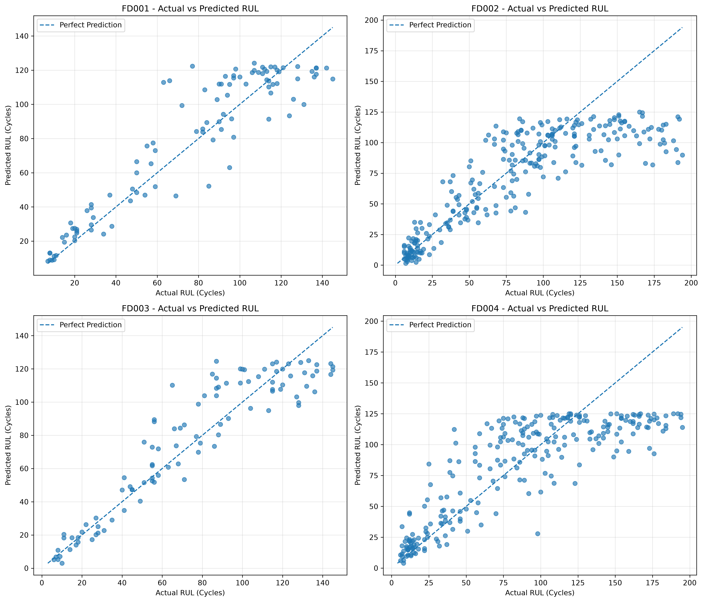

**Test Metrics**

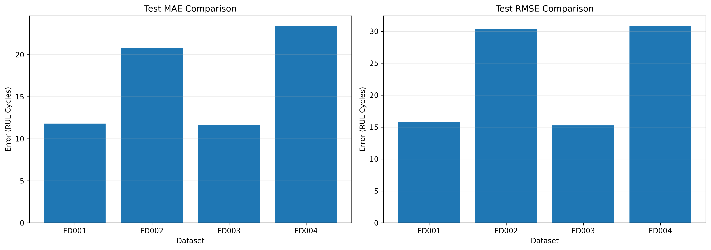

**MAE Comparison**

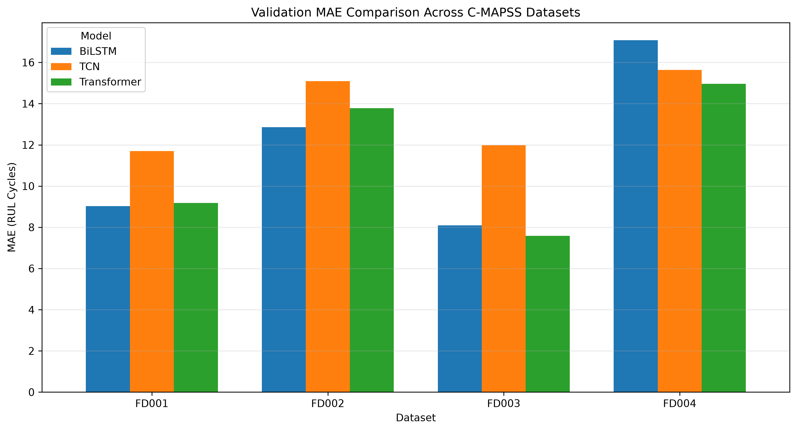

**NASA Score Comparison**

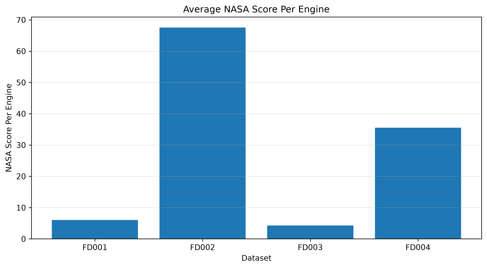

**Training Curves**

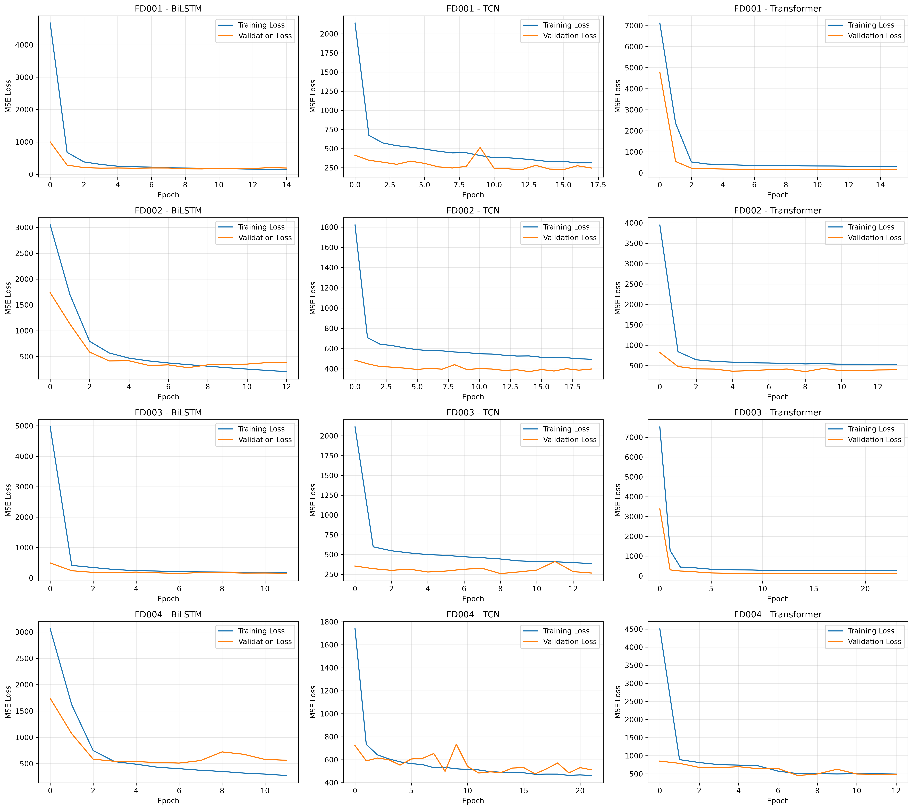

Additional evaluation results are available in `reports/metrics/`.

## Deployment

### FastAPI Backend

The FastAPI application supports predictions for all four datasets.

**Endpoints:**

| Method | Endpoint | Purpose |
|---|---|---|
| GET | `/` | API home |
| GET | `/health` | Health and supported-model status |
| POST | `/predict` | Predict engine RUL |

The prediction endpoint accepts:
- Dataset name: FD001, FD002, FD003, or FD004.
- Sensor data: 30 consecutive cycles with the corresponding dataset's feature count.

Feature counts:

| Dataset | Features per cycle |
|---|---:|
| FD001 | 18 |
| FD002 | 24 |
| FD003 | 19 |
| FD004 | 24 |

Example request structure:

```json
{
  "dataset": "FD001",
  "sensor_data": [
    [0.1, 0.2, 0.3]
  ]
}
```

The example above illustrates the request structure only. A valid request must contain exactly 30 rows, with 18, 24, 19, or 24 values per row depending on the selected dataset.

### Streamlit Dashboard

The dashboard provides:

- Dataset selection (FD001–FD004).
- Engine selection.
- Engine cycle information.
- Sensor trend visualization.
- Model-specific RUL prediction.
- Illustrative maintenance status indicators.

The status thresholds are demonstration values, not validated aviation maintenance limits.

## Installation and Setup

### 1. Clone the repository

```bash
git clone <YOUR_GITHUB_REPOSITORY_URL>
cd Predictive_Maintenance_RUL
```

Replace the placeholder with your actual GitHub repository URL.

### 2. Create a virtual environment

```bash
python3 -m venv .venv
source .venv/bin/activate
```

### 3. Install dependencies

```bash
pip install -r requirements.txt
```

### 4. Prepare the dataset

Download NASA C-MAPSS and place its original files in:

```text
data/raw/CMAPSSData/
```

### 5. Start the FastAPI server

From the project root:

```bash
uvicorn app.main:app --reload
```

Open the API documentation:

`http://127.0.0.1:8000/docs`

### 6. Start the Streamlit dashboard

Open a second terminal, activate the same virtual environment, and run:

```bash
streamlit run dashboard/app.py
```

Open:

`http://localhost:8501`

### 7. Run automated tests

```bash
python -m pytest tests/test_multi_dataset_inference.py -v
```

## Project Structure

```text
Predictive_Maintenance_RUL/
│
├── app/
│   └── main.py
│
├── configs/
│   └── config.yaml
│
├── dashboard/
│   └── app.py
│
├── data/
│   ├── raw/
│   ├── interim/
│   └── processed/
│
├── artifacts/
│   ├── models/
│   ├── metrics/
│   ├── plots/
│   └── FD00X_preprocessing.pkl
│
├── notebooks/
│   ├── 01_data_understanding.ipynb
│   ├── 02_eda.ipynb
│   ├── 03_preprocessing.ipynb
│   ├── 04_model_experiments.ipynb
│   ├── 05_multi_dataset_analysis.ipynb
│   ├── 06_multi_dataset_preprocessing.ipynb
│   ├── 07_multi_dataset_model_training.ipynb
│   └── 08_multi_dataset_final_evaluation.ipynb
│
├── reports/
│   ├── metrics/
│   └── figures/
│
├── src/
│   └── inference/
│       ├── predict.py
│       └── multi_dataset_predict.py
│
├── tests/
│   └── test_multi_dataset_inference.py
│
├── requirements.txt
├── README.md
└── .gitignore
```

## Important Methodological Considerations and Limitations

- NASA C-MAPSS is a simulated turbofan benchmark, not real operational aircraft maintenance data.
- Training RUL labels are capped at 125 cycles, while official test RUL labels are uncapped.
- Predictions are clipped to the range 0–125 cycles. This can underestimate RUL for test engines whose true RUL exceeds 125 cycles.
- KMeans operating regimes for FD002 and FD004 are approximate clusters derived from operating settings.
- Short test histories are padded by repeating the earliest available observation to obtain fixed-length input windows.
- The TCN-style model is a dilated convolutional baseline and should not be interpreted as a fully causal TCN implementation.
- Maintenance status thresholds are illustrative and are not validated for real-world aircraft maintenance.
- This project is an educational and portfolio demonstration, not a safety-critical maintenance decision system.

## Future Improvements

- Experiment with regime-aware normalization for FD002 and FD004.
- Explore alternative RUL caps and uncapped training targets.
- Improve generalization across operating conditions.
- Add model monitoring and prediction logging.
- Optimize model loading and inference latency.
- Explore uncertainty estimation for RUL predictions.

## Author

Developed as a deep learning and predictive maintenance portfolio project using NASA C-MAPSS turbofan engine degradation data.


## Dashboard Screenshots

The interactive dashboard supports all four NASA C-MAPSS datasets.

### FD001

<details>
<summary>View FD001 dashboard screenshots</summary>

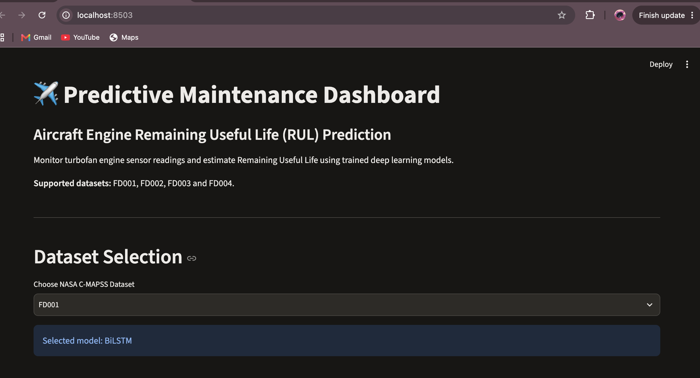
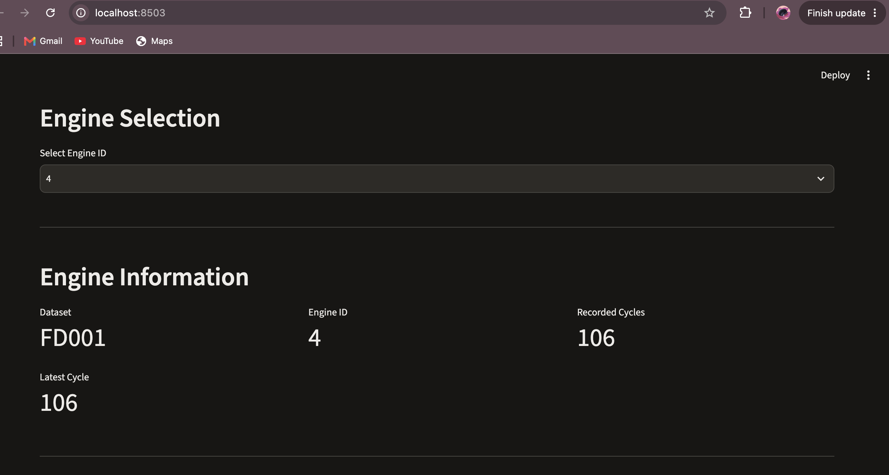
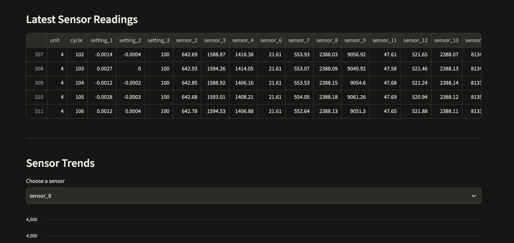
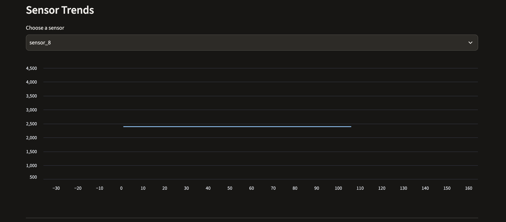
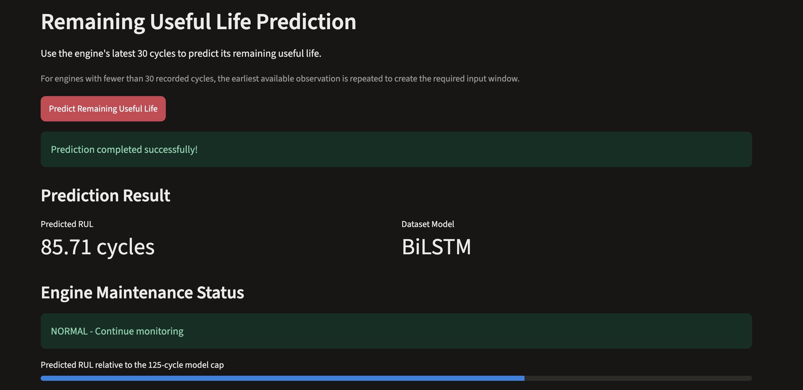

</details>

### FD002

<details>
<summary>View FD002 dashboard screenshots</summary>

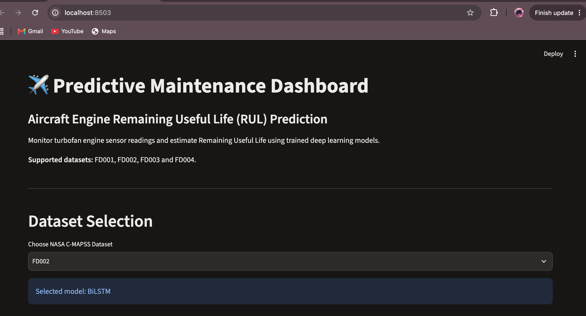
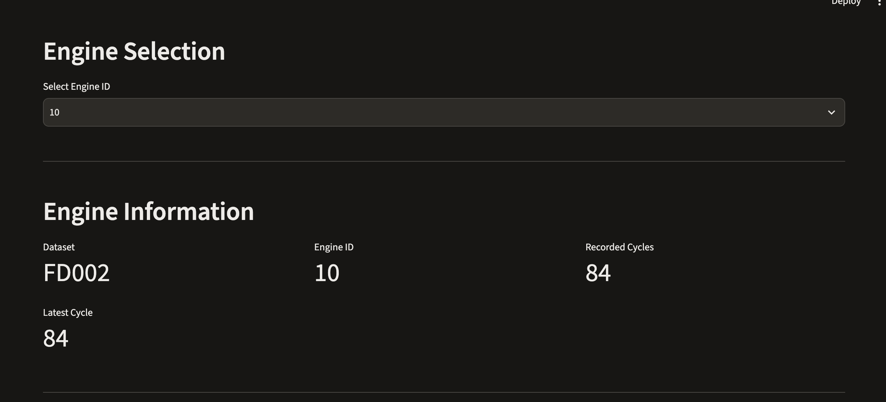
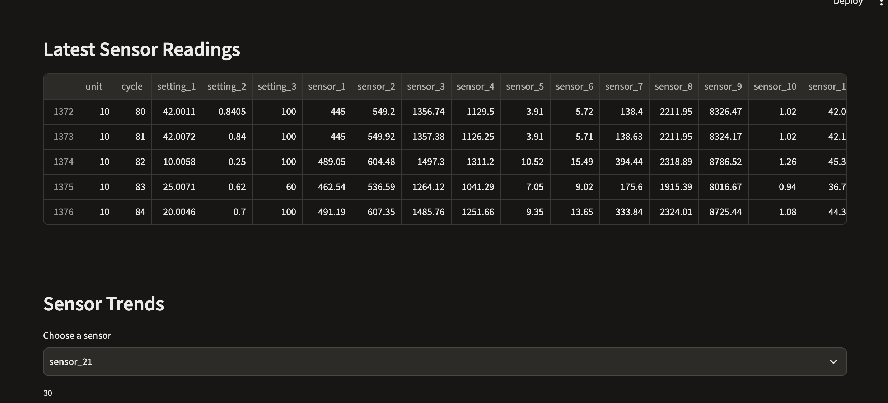
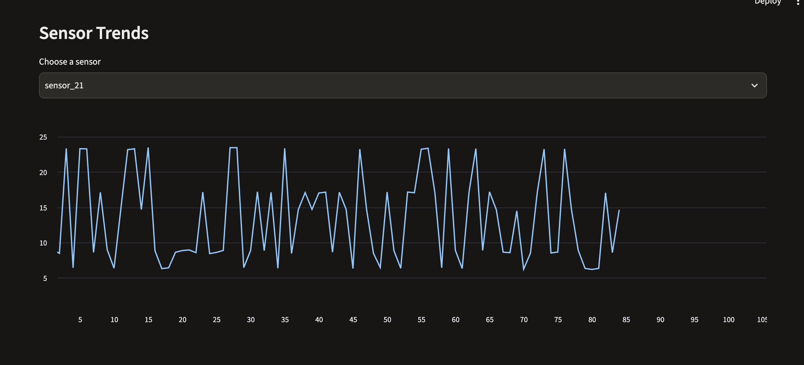
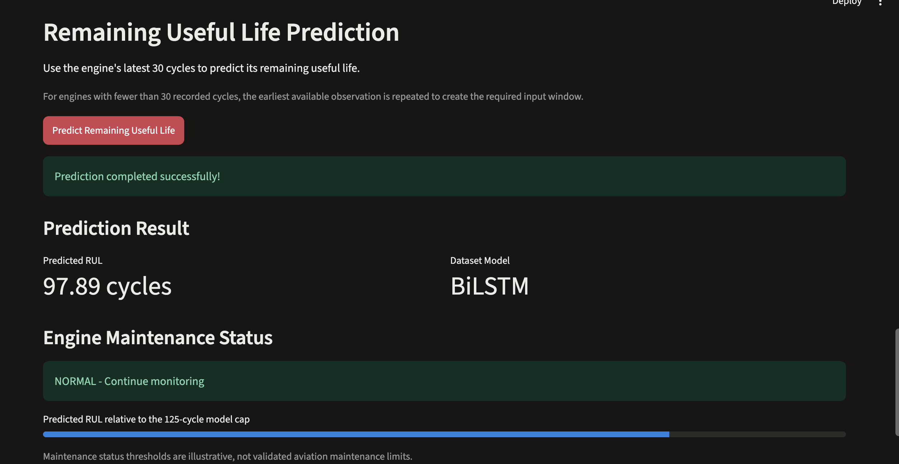

</details>

### FD003

<details>
<summary>View FD003 dashboard screenshots</summary>

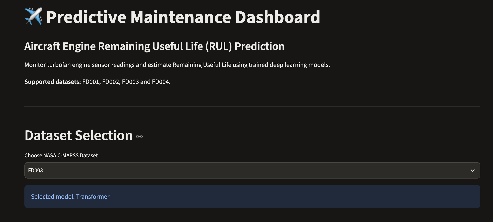
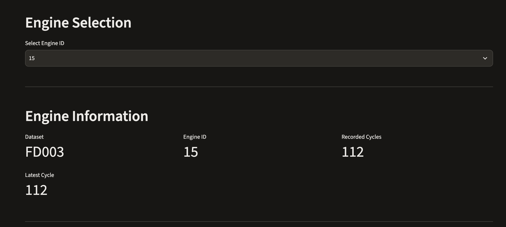
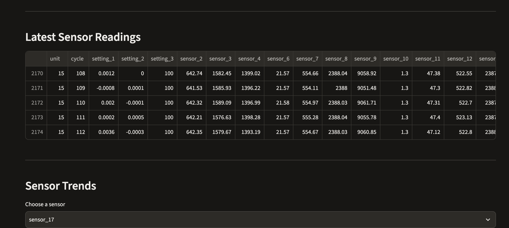
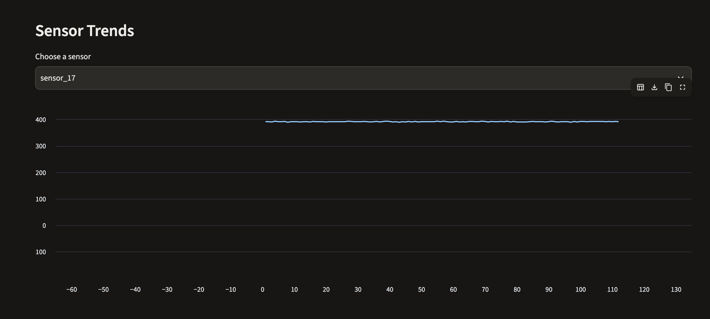
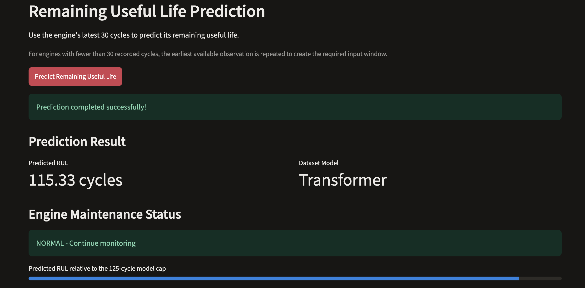

</details>

### FD004

<details>
<summary>View FD004 dashboard screenshots</summary>

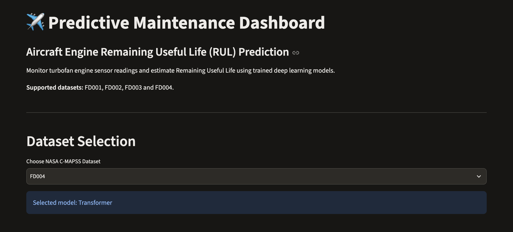
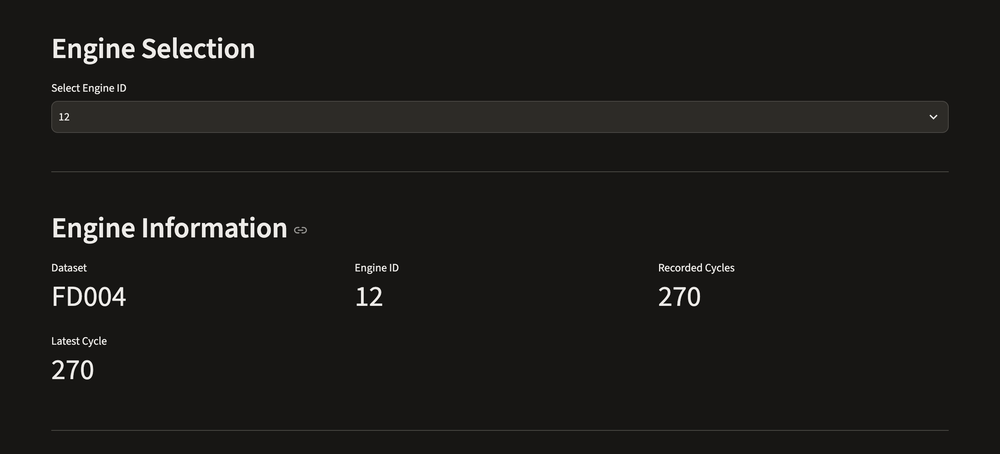
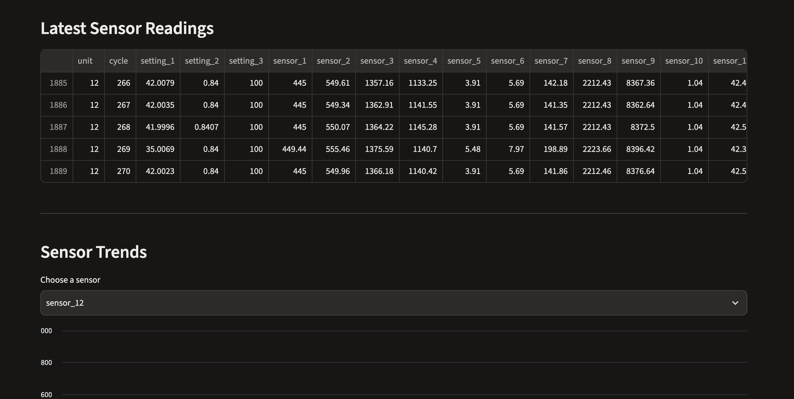
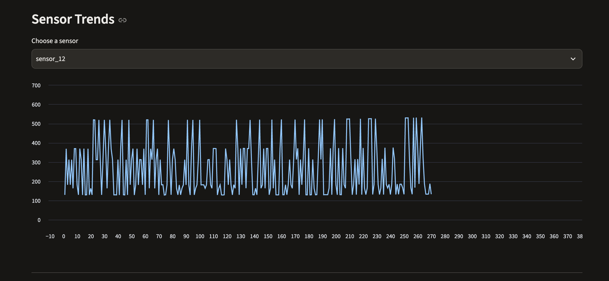
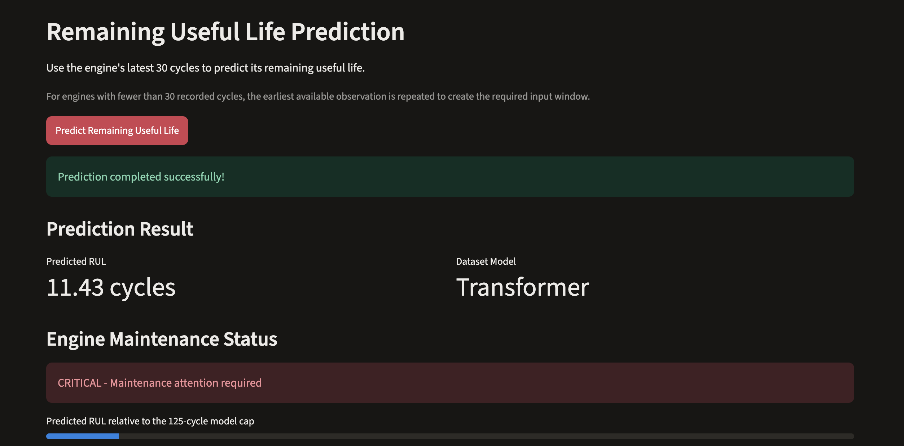

</details>

## Acknowledgements

Dataset: NASA C-MAPSS Turbofan Engine Degradation Simulation Data, NASA Prognostics Data Repository.
